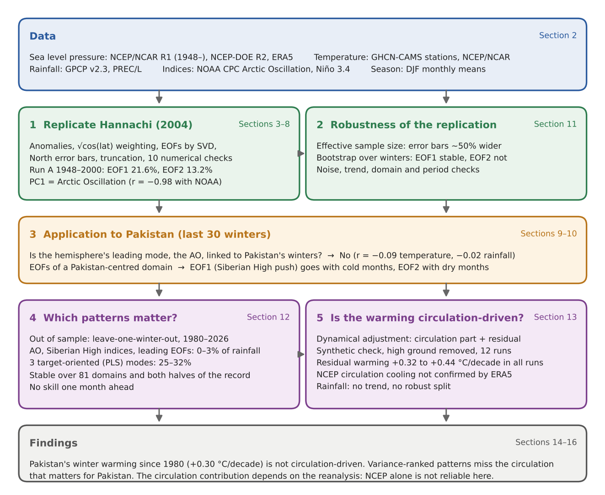

# Pakistan's Winter Warming Is Not Circulation-Driven

**EOF replication and cross-validated dynamical adjustment of Pakistan's winter climate, 1980–2026**

This project reimplements the EOF method of Hannachi (2004), *A primer for EOF analysis of climate data*, and applies it to Pakistan's winters (December–February). It asks two questions: which atmospheric pressure patterns actually matter for Pakistan's winter temperature and rainfall, and how much of Pakistan's winter warming since 1980 is driven by changes in the circulation.

Everything is in one notebook, `pakistan_winter_eof_analysis.ipynb`, which downloads its own data and runs in Google Colab.


## Key findings

- **Pakistan's winter warming is not circulation-driven.** Pakistan warmed by +0.30 °C per decade in winter since 1980. After removing the part explained by the circulation, the residual warming is **+0.32 to +0.44 °C per decade in all 12 configurations tested**, never smaller than the observed trend.
- **The patterns that dominate pressure variance are not the ones that matter for Pakistan.** Tested on winters they have not seen, the Arctic Oscillation, Siberian High indices and the leading EOFs explain **0–3%** of monthly winter rainfall. Three patterns chosen for their link to Pakistan explain **25–32%** of rainfall and temperature.
- **The circulation contribution depends on the reanalysis.** NCEP pressure suggests that the circulation offset part of the warming (−0.13 °C per decade). ERA5 does not confirm it (−0.02 °C per decade, p = 0.63).
- **The record warm winters of 2024–2026 were warm mainly through the residual, not the circulation.**
- **Winter rainfall shows no trend since 1980.**
- **The replication works.** The paper's 21% and 13% are reproduced (21.6% and 13.2%), but only with √cos(latitude) weighting.


## Research questions

### Main questions

| | Question | Answer |
|---|---|---|
| **RQ1** | Are the pressure patterns that dominate the variance the ones that matter for Pakistan's winters? | **No.** Variance-ranked patterns explain 0–3% of unseen rainfall; target-oriented patterns explain 25–32%. |
| **RQ2** | How much of Pakistan's winter warming since 1980 is driven by the circulation? | **None robustly.** Residual warming is +0.32 to +0.44 °C per decade in every configuration. |

### Supporting questions

| | Question | Answer |
|---|---|---|
| RQ3 | Can Hannachi (2004) be reproduced? | Yes, with √cos(latitude) weighting. |
| RQ4 | How robust are the paper's modes? | EOF1 is robust; EOF2 is not. |
| RQ5 | Does the Arctic Oscillation shape Pakistan's winters? | No (r = −0.09 temperature, −0.02 rainfall). |
| RQ6 | Does the answer depend on the analyst's domain? | The mode label does; the information does not (81 domains tested). |
| RQ7 | Can sea level pressure forecast the next month? | No, and neither can Niño 3.4. |
| RQ8 | Does the circulation contribution depend on the reanalysis? | Yes: NCEP and ERA5 disagree. |
| RQ9 | Were the record warm winters of 2024–2026 caused by the circulation? | No, mainly by the residual. |
| RQ10 | Has winter rainfall changed since 1980? | No significant trend. |

The notebook gives each answer with its numbers and the section where it is tested.


## Workflow



## Repository contents

| File | What it is |
|---|---|
| `pakistan_winter_eof_analysis.ipynb` | The full analysis: replication, application, out-of-sample tests and dynamical adjustment, with all figures and results |
| `Literature_review_circulation_controls_on_Pakistans_winter_climate.docx` | Review of 15 studies from 2022–2026 and the research gap |
| `review_bundle.zip` | Produced by the notebook: every figure, table and a run summary |

---

## Data

All data are monthly means, downloaded automatically by the notebook.

| Variable | Dataset | Provider |
|---|---|---|
| Sea level pressure | NCEP/NCAR Reanalysis 1, NCEP-DOE Reanalysis 2 | NOAA PSL |
| Sea level pressure | ERA5 monthly averaged data on single levels | Copernicus Climate Change Service |
| Temperature | GHCN-CAMS (stations), NCEP/NCAR Reanalysis 1 | NOAA PSL |
| Precipitation | GPCP v2.3, PREC/L | NOAA PSL |
| Indices | Arctic Oscillation, Niño 3.4 | NOAA CPC, NOAA PSL |

ERA5 is used under the CC BY 4.0 licence: Copernicus Climate Change Service (C3S) (2019), *ERA5 monthly averaged data on single levels from 1940 to present*, https://doi.org/10.24381/cds.f17050d7.


## How to run

1. **Open the notebook in Google Colab.**
2. **Add your Copernicus token for ERA5.**
   - Create a free account at the [Climate Data Store](https://cds.climate.copernicus.eu).
   - Accept the Terms of Use on the dataset page for *ERA5 monthly averaged data on single levels from 1940 to present*.
   - Copy your personal access token from the [API page](https://cds.climate.copernicus.eu/how-to-api).
   - In Colab, open the key icon in the left sidebar, add a secret named `CDS_TOKEN` with the token as its value, and turn on notebook access.
3. **Run all cells.** The first run downloads about 700 MB of NOAA data and about 1 MB of ERA5. Without a token, everything except the ERA5 runs still works.

To run locally instead, install the requirements and set `CDS_TOKEN` in the ERA5 download cell:

```bash
pip install numpy pandas scipy xarray matplotlib cartopy shapely netCDF4 h5netcdf cdsapi
```


## Outputs

The last code cell writes every figure to `review/figures/`, every table to `review/tables/` and a run summary to `review/summary.json`, then zips them into `review_bundle.zip`. Key figures:

| Figure | Shows |
|---|---|
| 1–3 | Replication of the paper's Figures 1–3 |
| 18 | Where the Pakistan signal sits in the EOF spectrum |
| 19 | Out-of-sample skill against the number of patterns |
| 21 | Observed, circulation and residual winter trends |
| 23 | The trend split across all 12 configurations |
| 25 | Pressure trends in NCEP and ERA5 |


## Methods in brief

- **EOFs** by singular value decomposition of area-weighted DJF sea level pressure anomalies, following Hannachi (2004).
- **Out-of-sample skill** by leave-one-winter-out cross-validation, refitting the climatology, patterns and regression in every fold.
- **Target-oriented patterns** by partial least squares: pressure patterns ranked by their covariance with Pakistan's temperature or rainfall, not by variance.
- **Dynamical adjustment** splits each month into a circulation part, predicted from pressure using a relation learnt on detrended data, and a residual. It uses pressure below 1500 m only, is checked on synthetic targets with a known answer, and is tested with two methods, three elevation cut-offs, three domains, three numbers of patterns, two temperature datasets and three reanalyses.

## Limitations

- Sea level pressure explains only 11–29% of the year-to-year variance of Pakistan's winter temperature, so the circulation part of the trend is uncertain.
- The residual is not purely thermodynamic warming. It also holds circulation that sea level pressure misses, such as upper-level jet changes, as well as land-surface and aerosol effects.
- The rainfall results rest on GPCP; the gauge-based PREC/L disagrees, and station data are needed.
- The results are diagnostic: pressure explains the same month's weather but does not forecast the next.


## Key references

- Hannachi, A. (2004). *A primer for EOF analysis of climate data*. University of Reading.
- Deser, C., and Phillips, A. S. (2023). A range of outcomes: the combined effects of internal variability and anthropogenic forcing on regional climate trends over Europe. *Nonlinear Processes in Geophysics*, 30, 63–84.
- Hunt, K. M. R., et al. (2025). Western disturbances and climate variability: a review of recent developments. *Weather and Climate Dynamics*, 6, 43–112.
- Pfleiderer, P., et al. (2026). Considerable yet contrasting regional imprint of circulation change on summer temperature trends across the Northern Hemisphere mid-latitudes. *Weather and Climate Dynamics*, 7, 89–108.

The full reference list is at the end of the notebook and in the literature review.

## Acknowledgements
- **AI assistance:** an AI assistant (Claude, Fable 5.2 and Opus 5.5) were used to review and improve the code and documentation.
